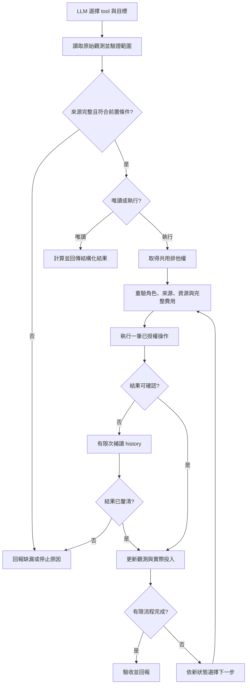

# 遊戲流程 tools 實作計畫

## 目標與範圍

將八項重複流程做成 LLM 可呼叫的 tools，減少逐指令整理資料、計算與核驗的工作。使用 `exposure: "codemode"`，不新增 slash commands；使用者不需手動提供遊戲資料 JSON。

本文件只定義實作計畫，不啟用遊戲操作、背景工作或 Goal mode。規則與授權以 [AGENTS.md](AGENTS.md) 及[遊玩 skill](skills/playing-bear-of-bears/SKILL.md) 為準。規劃完成不代表八項功能已完成。

本次範圍：

| Tool | 類型 | 交付內容 |
| --- | --- | --- |
| `bears_combat_snapshot` | 本機唯讀 | 從原始遊戲觀測建立可追溯的戰鬥快照 |
| `bears_reconcile_rewards` | 本機唯讀 | 核對金幣、材料、物品與操作結果 |
| `bears_tower_recover` | 有狀態變更 | 確認星塔挑戰、收刀、恢復並驗證挑戰保留 |
| `bears_move_to` | 有狀態變更 | 依實際出口逐房步行，確認目的地 |
| `bears_equip_upgrade` | 有狀態變更 | 每次套用一件嚴格提升的已有裝備並驗證 |
| `bears_tower_entry_check` | 遊戲查詢 | 檢查當次免費資格、完整成本與可選樓層，不入塔 |
| `bears_plan_upgrade` | 唯讀研究 | 比較進化、精煉、合成候選的成本、材料缺口與已知效果 |
| `bears_balance_wallet` | 有狀態變更 | 依明確指定的同角色存款規則，最多存款一次並對帳 |

不包含交易、跨角色資源轉移、批次銷毀、角色建立／刪除／轉職、公開聊天、PvP、背景刷怪、排程、等待重生或未知機制的自動試打。付費強化與合成執行仍使用既有 tools，不納入 `bears_plan_upgrade`。

## 實作狀態

八個 tools 已整合於既有 bears extension；以下保留原設計範圍與驗收條件。**離線驗證完成，實機未驗證。** 完整證據及已知限制見 [逐項驗證紀錄](docs/plans/workflow-tools-verification.md)。本文件不新增遊戲授權，也不取代最新 [GOAL.md](GOAL.md)。下述承傷上界與 `mechanicsComplete` 限制是工具能力界線，不是現行手動戰鬥策略；遊戲出手條件依該契約，不由本計畫另設完整公式前置要求。

## 現有基礎與缺口

| 現有程式 | 可重用內容 | 實作前須處理的缺口 |
| --- | --- | --- |
| [extensions/bears.ts](extensions/bears.ts)、[src/game.ts](src/game.ts) | Telegram 操作、原始訊息、逐筆回覆與取消 | `Game` 操作鎖是 instance 內的鎖，不是所有流程與所有程序的帳號鎖 |
| [src/game-commands.ts](src/game-commands.ts) | 指令 schema、驗參數與固定序列化 | 目前只封裝單一指令，沒有多步流程狀態機 |
| [src/equipment-snapshot.ts](src/equipment-snapshot.ts) | 分支內快照、來源、完整性及失效機制 | 快照由 bears extension 持有，不可假設新 extension 已能存取 |
| [src/equipment-optimizer.ts](src/equipment-optimizer.ts) | 固定權重與嚴格提升推薦 | 沒有內建換裝、驗收或技能取捨判斷 |
| [src/idle-route.ts](src/idle-route.ts) | 避開 BOSS 的 BFS 路線搜尋 | 目前只處理四方向；一般步行須核對上／下與入口條件 |
| [src/auto-idle-state.ts](src/auto-idle-state.ts) | Auto Idle 排他控制 | 須與新流程協調，不能建立另一套互不相知的鎖 |
| [src/combat-planner.ts](src/combat-planner.ts)、[extensions/combat.ts](extensions/combat.ts) | 單步承傷預算與傷害招式排序原型 | 目前接受呼叫者整理的數值，尚未查驗原文、角色／樓層綁定與承傷上界 |

現有工作目錄已有未提交變更。實作各階段前重新檢查 diff，不覆寫既有檔案變更，也不將其他任務的修改併入交付。

## 共用設計

### Tool 介面

- 本機觀測由既有 bears 工具及 watch 的未精簡訊息建立，不由 LLM 重新輸入 HP、背包、餘額或完整性宣告來取代原始證據。
- LLM 輸入目標、策略及已授權範圍；執行型 tool 另綁定目前角色與準備階段產生的快照識別。
- 每個 tool 宣告 `outputSchema`，回傳相符的 `structuredContent`，並保留可讀摘要與 `details`。
- 共用回覆包含 schema version、狀態、角色／遭遇識別、來源、已確認步驟、缺漏、停止原因與下一步。
  - 執行型回覆另列實際支出、結果未知項目與最後確認狀態。
  - `ready`、`submitted`、`confirmed` 與 `outcome_unknown` 必須分開；送出不等於成功。
- 無法支持的格式回報缺漏，不補零、不推定成功、不以較短摘要隱藏資料衝突。

### 觀測與來源

- 每份快照保留角色、遭遇模式、位置、必要樓層／目標，以及 message ID、revision、訊息時間與本機觀測時間。
- 訊息時間與觀測時間分開；重讀歷史不能刷新舊狀態，也不能把看過訊息當作已重新核驗。
- 區分 Telegram 即時回覆、公開資料、歷史模板及呼叫者提供的假設。公開地圖不提供即時怪血或存活保證。
- 初期沿用既有新鮮度界線：戰鬥原型 60 秒、配裝 5 分鐘、公開查詢既有 12 秒快取；不得以包裝新 tool 延長期限。
  - 靜態技能／機制資料若需不同新鮮度，先訂定變更與失效條件，再調整 schema；不為通過檢查而反覆查詢。
- 切角、換裝、移動、戰鬥、樓層變化、相關訊息 revision 更新及 watch 缺頁時，依受影響範圍使觀測失效。
  - 能明確識別的其他角色掛機報告，不應無條件使目前角色快照失效。
  - 無法識別的活動或來源衝突採保守失效。
- 保留既有 `originalSourceId` 查閱能力。原文可供追查，不能取代結果不明時的新觀測。
- reload、session 切換與 tree 分支切換後，不恢復待送操作或可信的執行資格。

### 執行、排他與授權

1. 第一階段先完成唯讀核心與單步執行驗證，不直接開放多步自動狀態變更。
2. 開放多步執行前，確認適用授權已涵蓋該角色、目標、動作、費用及有限流程。
   - 同步檢查並調整 skill／操作文件中要求 Agent 逐筆核對的流程，使核驗責任明確落在已測試的 tool 狀態機；未釐清前保留 Agent 逐筆模式。
   - 不以 LLM 傳入的 `authorized: true`、plan ID 或本文件當作新增遊戲授權。
   - 帳號專屬比例、預算與任務條件不硬編碼成套件對所有使用者的授權。
3. 所有新流程重用既有 command dispatch 與觀測路徑，不另建 Telegram transport 或任意文字指令入口。
4. 在整個執行流程持有共用排他權，拒絕其他 Telegram 工具及 Auto Idle 插入操作。
   - 納入既有 send、click、結構化指令及 Auto Idle，不只鎖新 tools。
   - 內部子步驟須可識別流程歸屬，避免重入鎖造成 deadlock；歸屬不得由模型任意指定。
   - 保留工具 hooks、原文、快照失效及統計路徑；不因包成單一 tool 而跳過核驗。
   - 明示這是程序內排他，不宣稱能防止 Telegram 手動操作或其他程序。
   - 正常完成、錯誤、取消及 session shutdown 均須釋放排他權；清理可重複執行，不觸發額外遊戲操作。
5. 每步依上一筆已確認回覆選擇下一筆，不預排整批 Telegram 指令，也不並行呼叫。
6. 送出前重新比對相關來源的 message ID 與 revision，並核對角色、資源、費用及副作用。
7. 每次呼叫都有明確結束點；不建立持續工作、背景排程或自動續跑。
   - 次數／查詢／時間上限沿用適用規則與呼叫授權，不自行把原型上限變成使用者任務限制。
   - rate limit、取消、死亡、費用不符或身分不明時停止；結果不明最多補讀 history 兩次，仍不明即結束，不重送。
   - 不增加 `sleep`、重生輪詢或無限重試。取消後不自動送出補救或回滾指令。



## 各 tool 的實作與驗收

### 1. `bears_combat_snapshot`

- **前置條件與輸入**：已取得目前分支的遊戲觀測；LLM 指定 `boss` 或 `tower` 及已觀察目標，不提供替代原文的狀態數值。
- **處理**：解析本人狀態、當前目標、塔層、技能成本、明示的防護與效果；將每個欄位綁定來源，缺項回傳 `needs_observation`。
- **輸出**：快照、來源、新鮮度、已知／未知欄位及需要補查的項目；可供 `bears_plan_combat` 使用的觀測部分。
- **限制**：不送 Telegram 指令、不切角、不停止掛機，不從 ATK、consider 或一次實傷推完整承傷公式。原文可解析不代表安全上界已證明；不得自動填入 `mechanicsComplete=true`。
- **驗收**：角色混雜、編輯訊息、延遲回覆、缺頁、過期、死亡、切角、跨層、同名目標、未知技能與靜態／runtime 效果衝突均有測試；舊盾、DOT 與易傷不能跨狀態默認沿用。
- **整合**：保留 planner 既有計算測試，逐步改用原文快照供應狀態；外部提供的風險假設仍明確標記，不提升為已驗證資料。

### 2. `bears_reconcile_rewards`

- **前置條件與輸入**：同角色的前／後觀測識別，以及要核對的已觀察操作區間；初版只讀本機已保存資料，不為對帳自行結算掛機。
- **處理**：比較金幣、材料與物品數量，對照回執中的收入、消耗、入場費、強化費及一次性獎勵。
  - 金幣以實際餘額差為準；若涉及同角色存款，合併身上與金庫後區分內部轉存及真正費用。
  - 計算「實際差額 − 已確認收入與支出的淨額」，回傳未解釋差額，不把支出重扣一次。
  - 同 message ID／revision 去重；編輯同一回執時更新原事件，不另算一筆收入。
- **輸出**：實際差額、已確認事件、未解釋差額、材料／物品變化、缺漏與來源。來源完整且區間有實際時間時才計算淨 G／分鐘。
- **停止條件**：跨角色、缺少前後餘額、物品無法唯一比較或區間有無法歸因的活動時回報部分結果，不宣稱閉帳。未販售物品不計金幣價值。
- **驗收**：掛機預估與結算分離、首達獎與一般怪金分離、名目報酬與錢包差異、分頁重複、回執修訂、存款中性轉移及費用不符。

### 3. `bears_tower_recover`

- **前置條件與輸入**：目前角色及已確認的挑戰快照，授權涵蓋本次收刀與恢復；有適用的前庭恢復證據，不套用野外 BOSS 保血行為。
- **處理**：讀取目前挑戰與資源 → 必要時送出一次 `/flee` → 確認可恢復地點 → 確認免費才送 `/rest` → 新查 `/status` 與 `/tower`。
- **輸出**：實補 HP／MP、實際費用、原／新樓層與怪血、挑戰是否保留，以及最後確認狀態。
- **停止條件**：收刀未確認、免費條件不明、恢復被拒、費用不符、角色改變或挑戰消失。不得自行 `/tower quit`、`/tower go`、用藥、換裝或重新開戰。
- **驗收**：正常保留、已收刀／已滿資源、怪血變化、挑戰中止、非零費用、延遲、取消及結果不明；任何失敗都不重送逃跑或休息。

### 4. `bears_move_to`

- **前置條件與輸入**：已確認的目前角色與位置、可唯一識別的目的地，以及授權涵蓋的步行範圍；掛機／戰鬥狀態須先釐清。
- **處理**：重用地圖與 BFS，補足六方向；預設排除 BOSS 房間。每步只採當下已觀察出口，確認目的地後再前進。
- **輸出**：原定與實走路線、已確認步數、最後位置、是否到達及停止原因。
- **停止條件**：地圖失效、出口不符、入口資格或費用未知、意外進入戰鬥、超出本次範圍。不得改用 `/goto`、召回或付費護送補救，也不自動戰鬥。
- **驗收**：上下出口、單向出口、同名房間、不可達、途中出口變更、BOSS 阻路、掛機中斷風險、取消及目的地不符。到達只由遊戲回覆確認，不能只用公開地圖推定。

### 5. `bears_equip_upgrade`

- **前置條件與輸入**：目前角色、固定權重／既有策略，以及一件裝備變更的授權；重用現有 optimizer，不另外建立不同評分公式。
- **處理**：先核對掛機是否已結算 → 依序取得新 `/status` 與 `/inventory all` → 補足可確定的 inspect 缺項 → 重算 → 換裝前刷新背包與推薦 → 最多送出一次 equip → 新背包確認穿戴。
- **輸出**：原／新裝備、評分依據、實際穿戴驗收、費用、屬性證據及未處理取捨。回傳下一件候選不代表已授權連續套用。
- **停止條件**：任何不完整、重名歧義、編號改變、過期、資格不明、非嚴格提升或未涵蓋技能／被動／套裝差異。若仍在掛機，只回報需要先結算，不暗中停止或重啟。
- **驗收**：平手不換、負分不卸、完整背包多則拼接、精煉有效屬性、inspect 衝突、背包重編號、取消、費用異常及結果不明。失敗後不自動反向換裝。

### 6. `bears_tower_entry_check`

- **前置條件與輸入**：目前角色及希望檢查的起始樓層／免費要求；不為本次檢查切角或中斷掛機。
- **處理**：依序確認角色、目前挑戰、當次 `/tower` 費用、可選樓層，以及必要的本人入場資源。
- **輸出**：免費／付費／未知、完整成本與自動擇一條件、樓層資格、現有挑戰與缺漏；僅回傳檢查結果。
- **停止條件**：資格或費用不明、自動選用材料／金幣的條件未釐清。不得為確認價格而入塔，也不把當次免費推成每日固定重置。
- **驗收**：各角色資格不同、歷史免費但當次收費、已有挑戰、樓層不可選、材料不足時可能改扣金幣、缺項及延遲回覆；測試確認從未呼叫入塔或退出工具。

### 7. `bears_plan_upgrade`

- **前置條件與輸入**：目前角色、已核對的目標裝備與比較指標；讀取本人背包、forge／refine／craft 選單及必要的公開配方資料。
- **處理**：計算各候選的本人材料缺口、完整金幣成本、階段需求、實際選材與已知屬性差異。
  - 分開列出遊戲報價、稅費、完整總額與未知項，不將歷史差額套成固定稅率。
  - 配方缺少資料、有循環或涉及未授權處置時，標記該候選不可完整比較，不虛構合成路徑。
  - 材料掉落來源只作研究線索，不啟動打王或移動。
- **輸出**：候選比較、材料缺口、來源、已知成本／未知成本與下一步。不同評分指標不可混用，無法支持榜分或實戰收益時不推定提升。
- **停止條件**：本人持有、精煉有效值、選材、必要效果或完整費用不明時，不提供可直接付款的建議；其他可比較候選仍保留。
- **驗收**：漏列稅費、基值／有效值差異、多階進化材料、共享材料不能重複支用、消耗目前所需技能裝備、配方缺漏與價格矛盾；確認無任何付費或移除物品操作。

### 8. `bears_balance_wallet`

- **前置條件與輸入**：目前角色、明確指定的存款策略及本次存款授權；本人身上與同角色金庫餘額、入口與完整費用均可確認。
- **策略**：本 repository 的需求為 `T = C + V`；僅當 `T > 0` 且 `C > T × 20%` 時，一次存入 `D = C − floor(T × 10%) G`。費用另列，不默默改寫公式或為完成比例自動提款。
  - 套件不得把此帳號規則當成全體使用者預設；規則須由當次明確策略提供。
  - 數量計算須避免浮點比例與整數溢位造成錯誤。
- **處理**：取得同角色兩處餘額 → 計算 → 送出前重驗餘額、費用與資格 → 最多存入一次 → 核對兩處餘額及實支。
- **輸出**：原餘額、目標、實際存入、費用、後餘額、對帳結果與最後確認狀態。
- **停止條件**：遠端入口不允許、費用不明、餘額改變、身分不符或結果不明。不自動移動、提款、跨角轉移或補做第二筆存款。
- **驗收**：總額為 0、恰好 20%、超過 20%、向下取整、大數、費用不足、前後餘額變動、延遲及取消；確認同次核驗最多存款一次。

## 實作順序與工作分解

所有階段已完成實作與離線測試；下列勾選表示 coding 交付，不代表真實遊戲操作已驗證。逐項證據見 [驗證紀錄](docs/plans/workflow-tools-verification.md)。

### 階段 A：共用觀測與執行基礎

- [x] 盤點原始資料流、message revision、快照失效、原文保存與既有鎖的測試。
- [x] 定義最小的來源／結果型別，以及角色、遭遇與操作區間識別。
- [x] 定義多步流程的授權核驗責任，先保留逐筆 Agent 模式。
- [x] 整合流程排他、取消、結果不明及部分完成回報；不引入通用 workflow framework、任意指令 script runner、新環境變數或背景服務。
- [x] 為既有 Game、Auto Idle、send／click 與單指令 tools 補相容性測試。

### 階段 B：戰鬥快照與收益對帳

- [x] 實作 `bears_combat_snapshot`，接上原始觀測並測試 parser 與失效邊界。
- [x] 將快照接入既有 `bears_plan_combat`；保留未知風險與來源標記，不宣稱解決所有承傷上界。
- [x] 實作 `bears_reconcile_rewards`，先支持金幣與已確認材料／物品數量差額。
- [x] 用合成與去識別化的已確認格式做 replay，分開標示格式測試及歷史案例。

### 階段 C：星塔檢查與恢復

- [x] 先實作 `bears_tower_entry_check`，建立 tower 狀態解析與費用核驗。
- [x] 實作 `bears_tower_recover` 的單步核心與離線完整狀態機。
- [x] 規則及授權責任釐清後，才開放一次 tool 呼叫內的有限多步恢復；不自動入塔或接戰。

### 階段 D：導航與單件換裝

- [x] 將可重用路線搜尋從掛機政策中分離，保留 Auto Idle 現行行為，加入六方向驗證。
- [x] 實作 `bears_move_to`，先預算路線，再逐步核對實際出口與目的地。
- [x] 以最小介面重用現有裝備快照與 optimizer，不複製另一份可信狀態。
- [x] 實作 `bears_equip_upgrade`，每次最多換一件，不自動切角或管理掛機。

### 階段 E：強化研究與存款

- [x] 實作 `bears_plan_upgrade`，明確區分成本已知、缺價及效果不可比較。
- [x] 實作 `bears_balance_wallet` 的策略計算、單筆存款及前後對帳。
- [x] 驗證帳號專屬規則不會成為套件全域預設，也不會擴張交易或提款權限。

### 階段 F：套件整合與交付

- [x] 更新 tool descriptions、prompt guidelines、遊玩 skill 與 README，讓 LLM 可自行發現並選擇八個 tools。
- [x] 小型註冊函式優先整合到現有 extension；只有責任或生命週期不同時才新增 extension 入口與 `package.json` 宣告。
- [x] 每個流程的 parser、計算及狀態機保持緊密；只因可測性或獨立修改需要才拆檔，不建立八套 transport、鎖或觀測快取。
- [x] 如測試顯示巢狀流程影響原文、metrics 或 context 精簡，限於必要範圍修正並加回歸測試。
- [x] 更新文件入口，保留既有遊戲目標與紀錄，不把本計畫當成 GOAL.md 或遊戲進展。

## 測試與完成條件

### 必須涵蓋的共通情境

1. schema 拒絕未知欄位、錯誤型別、控制字元、非有限數與非法資源數量。
2. parser 保留來源、完整性、未知欄位與矛盾，不把合成 fixture 當實機格式保證。
3. 角色改變、跨層、訊息修訂、分頁缺漏、過期與外部活動使相關計畫失效。
4. 操作前後同時核對 message ID 與 revision，不只比 revision 或摘要。
5. 兩個流程並行、流程與單指令並行、流程與 Auto Idle 並行均不會交錯送出。
6. 取消前未送出、取消後可能已送出、rate limit、無即時回覆及晚到回覆分開處理；不重送不明操作。
7. 部分成功後準確回報最後狀態，不自動回滾、不把整批重跑當復原。
8. 原文索引、巢狀呼叫、structuredContent、觀測失效及統計維持一致；不重複計入同一子操作。
9. extension 載入、reload、session／tree 切換不送遊戲指令，也不恢復待執行流程；沒有新增 slash command、輪詢或背景工作。
10. 八項 tools 的正常路徑、停止條件及禁止副作用均有獨立測試。

### 每階段執行的檢查

```bash
npm test -- <該階段新增或受影響的測試路徑>
npm run build
```

`<該階段新增或受影響的測試路徑>` 須替換為實際測試檔案。最終整合執行：

```bash
npm run check:ci
npm test
npm run build
git diff --check
```

八個 tools 均完成介面、實作、離線測試、文件與套件載入驗證後，才可宣稱本 coding 計畫完成。未進行實機測試時，交付必須明示「離線驗證完成，實機未驗證」；不得用 build 或測試通過宣稱遊戲操作安全。實機驗證另依當時授權選擇低風險操作，不為驗收強迫花費或測致死機制。

## 參考與待驗證事項

- [指令參考](skills/playing-bear-of-bears/commands.md)及[結構化 tools 對照](skills/playing-bear-of-bears/references/structured-tools.md)：現有入口與副作用；新增流程不得猜測指令。
- [配裝 skill](skills/bears-equipment-strategy/SKILL.md)：固定權重、完整背包、嚴格提升與效果取捨。
- [2026-10-17 星塔免費入場查證](docs/investigations/tower-free-entry-verification-2026-10-17.md)：免費資格須逐角即時核對，重置規則仍未確認。
- 本機星塔承傷研究 `docs/investigations/tower-damage-bounds-2026-10-17.md` 屬既有遊戲紀錄，不納入本次 coding 提交；模型與實績不等於完整公式或跨角色安全證明。
- [金幣收益參考](skills/playing-bear-of-bears/references/gold-earning.md)：只以已結算差額及完整時間計算實現收益；歷史販售案例不解除目前交易禁令。
- 實作前仍須確認：恢復與存款的現行回覆格式、完整費用來源、房間入口條件，以及現有觀測是否足以唯一綁定目標。這些缺口只阻擋相依步驟，不停止其他可完成的階段。
