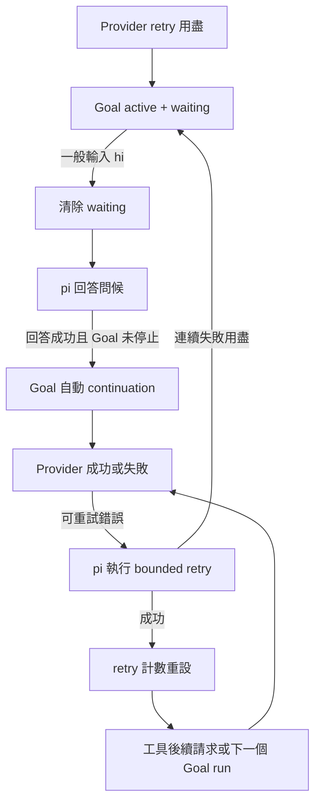

# pi-goal 與 Codex 錯誤持續出現的因果調查

## 結論

**已證實 pi-goal 會把普通 follow-up（包括 `hi`）當成喚醒 waiting Goal 的事件；成功回答後會自動續做原任務。** 這能解釋「想測試對話，卻再次看到一串錯誤」。尚未證實 pi-goal 造成 Codex 的一般 processing error。

另外已重現 user scope 安裝版 `0.54.4` 的舊 prefix 問題，但後續查證發現：此專案配置的是 project scope `0.54.11`，安裝時間早於事發 session 啟動。**撤回把 `0.54.4` 缺陷當成此 pane 已知問題或升級解法的建議。** 詳見 [request 續查](codex-request-investigation-2026-10-13.md)。

前一份 provider／Herdr 證據見 [Codex 錯誤調查](codex-error-investigation-2026-10-13.md)。本次只研究與離線測試，沒有送出 live model 請求、遊戲操作、Herdr prompt，也沒有停止 Goal、修改使用者設定或更新套件。

## 已證實的觸發流程

以下行號來自 user scope `~/.pi/agent/npm/node_modules/@narumitw/pi-goal/src/` 的 `0.54.4`；後續已確認 project scope `0.54.11` 也保留同樣的 waiting／follow-up／continuation 語意，不能以 user scope 版本代表另一個 pane 的載入版本。

1. `runtime.ts:879–899`：provider recovery 在 settled 時用 `enterGoalWait` 保存 `waiting`。Goal 的 status 仍是 `active`，不是 `paused`。
2. `lifecycle.ts:226–258`：普通 input 不判斷是否要求恢復 Goal；只要 Goal 正在 waiting，就呼叫 `clearGoalWait`。不是只有 `/goal resume` 才能恢復。
3. `lifecycle.ts:389–459`：一般使用者 prompt 在 Goal active 時仍納入這個 Goal 的 manual run。
4. `lifecycle.ts:493–580`：回答成功後，只要 Goal 仍 active 且符合限制，就 `requestContinuation`。
5. `lifecycle.ts:582–593`、`runtime.ts:397–451`：在 settled、idle 且沒有 pending message 時，透過 `sendUserMessage(..., { deliverAs: "followUp" })` 送出原任務 continuation。



這是目前產品行為，不是從 session 推測的流程。既有 `goal-error-lifecycle.test.ts` 也明確測試 follow-up 會喚醒 provider-recovery wait。對「只想聊天或診斷，不想重啟任務」的使用者而言，這個語意容易產生誤解。

## 為什麼 maxRetries=5 還能看到超過 6 次請求

Retry 是 pi core 執行，不是 pi-goal 自建的 model retry loop。

- pi `dist/core/agent-session.js:779–788`：任何非 error 的 assistant 回覆都會把 `_retryAttempt` 重設成 0；tool-call 回覆也包含在內。
- 因此 `maxRetries=5` 是連續失敗的上限，不是整個 Goal 的總請求數上限。
- pi-goal 的 provider-error 分支保存 recovery 並取消自己的 continuation；直到 settled 才進入等待，沒有另一層無限 error retry。
- 目前 Goal 設定 `continuationLimits.automaticTurns: null`，表示 Unlimited；`noProgressTurns: 3` 則只檢查成功 automatic run 的重複 tool-free 輸出，不是 provider 失敗或低遊戲收益的熔斷器。
- 此專案已有 Unlimited 遊玩授權；本調查沒有改成固定次數限制。

實際 session 的自動 continuation #22 只出現一筆 user message：entry `e3487f21`（16:13:55.417，Asia/Taipei）。之後 processing error／成功 tool call 交錯，是同一個 continuation 裡的 retry 與 tool loop，不是每一個 error 都重新插入一筆 Goal prompt。

- 16:13:57–16:14:09：3 筆 error。
- 16:14:25.726：成功 `bears_history` 回覆，retry 計數可以重設。
- 16:14:28–16:14:32：2 筆 error。
- 16:14:51.686：再次成功 `bears_history` 回覆，再次重設。
- 16:14:58.465–16:16:17.358：6 筆連續 error（初次加 5 次 retry）。
- 16:16:17.369：entry `4b82f1bc` 保存 `Provider retries exhausted` waiting，沒有下一筆 Goal continuation。

這段共 11 筆 error 與 2 筆成功 tool-call 回覆。觀測範圍是此 user continuation 到最後 waiting；不是累計整個 session。

## Counter 與 context 不可混淆

`lifecycle.ts` 會在 `agent_end` 增加 iteration，因此 provider retry 也可能讓 iteration 增加。不能把 `iteration: 33` 當成已送出 33 筆 continuation 或取得 33 次遊戲進展。

原始 active branch 在此次讀取時包含：

- 6 筆帶 continuation marker 的 user message，共 20,396 characters；最後一筆 3,401 characters。
- 3 筆 persisted Goal contract，共 9,882 characters，內容相同；其中兩筆出現在 compaction 後。
- 最新成功 model call usage 約 196K tokens。

以上是原始 branch 的統計，**不是 compaction 後實際 provider input 的精確大小**。被 compaction 排除的歷史不應拿來指控全部重複送出；`goal-state` 是 `appendEntry` 的非 model context 狀態，也不能把保存次數直接換算成 prompt 膨脹。

## 已重現的舊版 prefix 問題

安裝版 `0.54.4` 的 `goal-contract.ts:81–99` 在 messages 前面有 summary、且缺少 Goal contract 時，會把恢復的 contract 放在 summary 後、retained messages 前。稍後即時保存的 contract 卻位於 retained history 後。

離線重現的兩種順序：

```text
暫時恢復：[summary, goal-contract, retained-user]
稍後保存：[summary, retained-user, goal-contract]
```

這會改變 existing request prefix；已證實的是 prefix 不一致，沒有測試或證據證明 Codex 必然拒絕這種轉換。

本機 source `0.54.11` 的修正讓恢復位置與保存位置都使用 tail，並處理 streaming 期間延後保存的 contract。`CHANGELOG.md` 的 `0.54.10`、`0.54.11` 分別記錄這兩類 prefix 修正。

事發 session 的 compaction 是 13:08:50 與 13:42:22；對應 contract 在約 7 秒後保存。15:00 與 16:13 的 error burst 沒有相鄰的 compaction entry。因此這是相關舊版缺陷，但**時間線不支持直接宣稱它造成這兩批錯誤**。

## 離線驗證

### 已安裝 0.54.4

使用隔離的暫存 `PI_CODING_AGENT_DIR`，Jiti 載入已安裝 source，搭配本機 test mock；pi-ai root alias 對應 pi core 的 `compat.js`，避免把 extension loader 提供的 peer dependency 行為誤判成 package 缺陷。

三個 assertion 通過：

1. Error 後 settled：進入 waiting，不額外發 Goal prompt。
2. 輸入 `hi`：waiting 清除；成功問候後發出一筆 Goal continuation。
3. 重複 settled：不重複發 continuation。

另一組純函式 assertion 通過：安裝版缺 contract 的暫時恢復順序與 tail 保存順序不同；本機新版兩者相同。

Harness 初次嘗試分別缺少 Jiti、peer alias 與 active Goal tools；補上與 pi loader／既有 fixture 一致的條件後才通過。這些是離線 harness 準備問題，不是 live agent 的故障證據。暫存資料已清除。

### 本機 source 0.54.11

執行既有 3 個 Vitest 檔，共 **55 tests 通過**：

```text
packages/pi-goal/test/goal-error-lifecycle.test.ts
packages/pi-goal/test/goal-continuation.test.ts
packages/pi-goal/test/goal-cache-contract.test.ts
```

這些測試驗證本機新版的 lifecycle 與 prefix 行為，不宣稱測得 OpenAI 的真實後端。

## `/goal resume` 後的 Herdr 觀測：16:30 左右

使用者回報 `/goal resume` 沒有作用後，唯讀查閱 `w6A:p1` 的近期畫面。畫面已出現明確 resume prompt，保留原 Goal ID，因此不是指令未被接受。

- 16:30:14、16:30:19、16:30:29 的畫面請求起始時間對應 3 筆 processing error；request ID 分別為 `35f9673d-3a0c-499c-895b-b21ff5c63c63`、`f1856130-68b7-4917-92fd-0f5c7682149e`、`4ff5473c-d00e-4ba9-99d4-45a894f34173`。
- 隨後畫面已顯示 model 產生 `bears_send` tool call，內容為切換角色；觀測時工具仍在執行，沒有可用的完成結果，不能宣稱切角成功或整個 Goal 已恢復健康。
- 因此 resume 已生效，但 provider error 仍存在，之後至少成功產生工具呼叫。這再次顯示恢復語意與 provider 請求失敗是不同問題。
- 先前「應改成只由明確 resume 喚醒」的建議只處理普通聊天意外重啟任務，不是這次 processing error 的已證實修復。不得因為使用者已 resume 就重複建議 resume 作為解法。
- 本次沒有送出 prompt、重送遊戲操作、停止 Goal 或重啟 pane。

## 建議與未驗部分

- **對話與任務恢復應分開判斷。** 若需要避免普通聊天自動重啟 provider-recovery waiting，應先定義只由明確 resume／指定 wake event 喚醒的行為，再補測試；本次未變更既有產品語意。
- **不要把成功 tool call 當成 provider 已全面恢復。** 可研究用故障事件範圍追蹤 success/error，而不是只看連續失敗數；不擅自新增固定總操作門檻。
- **撤回將升級當成此 pane 下一步的建議。** 專案配置已有 project scope `0.54.11`，事發前已安裝。未直接查得 process 的載入模組清單，但不能忽略 project scope 而以 user scope `0.54.4` 判定它過舊；本次沒有更新其他 pane。
- **若要證實 Goal prompt 本身觸發 Codex error，需要 live 對照。** 至少固定 model、tools、retained context 與 transport，比較普通 prompt 與 continuation；不得只比較本短 session 與另一個長 session。離線測試不能替代這項證據。
- 一般 processing error 的 provider code、transport、HTTP status 仍缺漏，應用去敏感化診斷取得；不保存完整 prompt、headers 或憑證。
