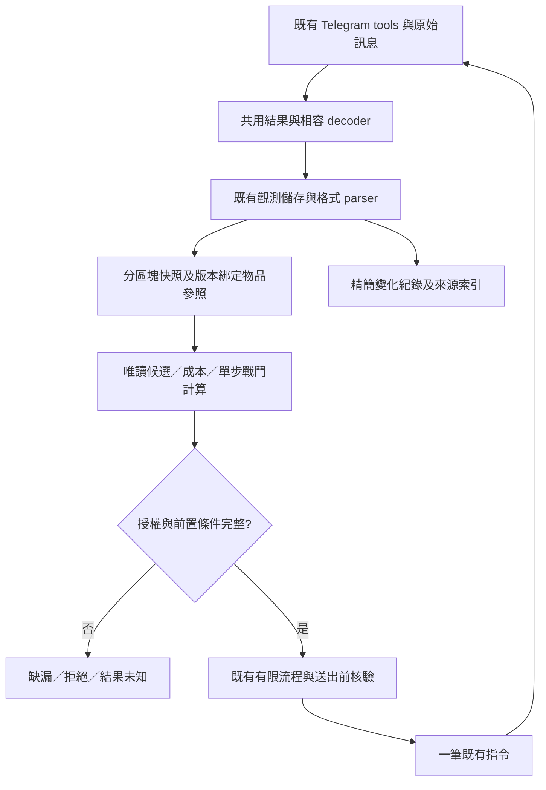

# Agent 與 extension 安全性及效率改進計畫

> 2026-10-19 建立，2026-10-20 +0800 更新。狀態：五個查詢工具、summary 與原生 forge 選單的常駐唯讀測項已通過；固定六案例受控比較及已列故障回歸已交付，token 降低74.6%。68檔／1,222項測試及 Pi SDK1.3.0 隔離測試通過。使用者已回報最後 reload，程式指紋與驗收版本一致；真實模型端到端與遊戲副作用仍未驗證，不宣稱全部實機驗收完成。證據見第8～15節及[離線驗收](2026-10-19_agent-extension-acceptance.md)。本文件不啟用 Goal mode、不新增遊戲授權。

## 1. 目標與範圍

以既有觀測、快照及有限流程為基礎，減少 Agent 搬運原文、拆解回傳及重複查詢的工作。先修正已觀察到的格式缺口，再完成三項核心改進：

1. 共用結構化回傳與相容解碼。
2. 綁定角色及背包版本的物品參照。
3. 可追溯、按需補查的狀態快照。

後續才處理戰鬥事件、完整成本報價與 Agent 紀錄流程。不重新建立 Telegram transport、快取、鎖或通用 workflow framework。

### 不在本輪實作範圍

- 後端未提供的永久物品 ID、原子快照、battle ID、報價鎖價及跨程序 exactly-once 保證。
- 背景刷怪、等待重生、任意操作迴圈、逾時自動重送或 reload 後自動恢復。
- 新增交易、跨角色資源轉移、自動切角、停掛／重掛或自動付款權限。
- 為通過測試延長 TTL、放寬完整性檢查，或把未知傷害與成本補成零。
- 一次改寫所有 tools，或新增尚無需求的設定、環境變數及持久化服務。

## 2. 已核對的現有能力與實際缺口

以下依本次讀取的程式入口整理，不把舊計畫的勾選當成本次驗收。既有總體設計見 [PLAN.md](../../PLAN.md)，離線驗證紀錄見 [workflow-tools-verification.md](workflow-tools-verification.md)。

| 範圍 | 現有能力與入口 | 本計畫要處理的缺口 |
| --- | --- | --- |
| 原文及輸出 | [output.ts](../../src/output.ts) 已保存 `details.bearsOriginal`，另附 source ID，並處理截斷預覽 | 基礎 tools 可呈現為兩個文字區塊；Agent 反覆拆 JSON 與尾端 source ID。需確認 Codemode 的實際可見格式，不能只增加後端欄位就宣稱解決 |
| 結構化流程結果 | [workflow-result.ts](../../src/workflow-result.ts)、[workflow-tools.ts](../../src/workflow-tools.ts) 已有 version、state、actor、sources、steps、blockers 及 `structuredContent` | 基礎 tools 與流程 tools 的消費介面仍不同；不應另造第二套流程狀態 |
| 物品參照 | [equipment-snapshot.ts](../../src/equipment-snapshot.ts) 已綁定原文、完整背包與 inspect，並核對有效屬性及五分鐘時效 | 目前的 `itemId` 使用背包列號，不是後端永久 ID；換裝後列號改變，不能跨背包直接沿用 |
| 快照 | [workflow-observations.ts](../../src/workflow-observations.ts)、[workflow-combat.ts](../../src/workflow-combat.ts) 已整理 status、inventory、home、room、skills、runtime effects 及來源 | `bears_combat_snapshot` 是本機唯讀，不會自行補查。解析格式與缺漏提示仍影響實際可用性；快照也不是原子狀態 |
| 有限流程 | [workflow-runner.ts](../../src/workflow-runner.ts) 已逐步確認，結果不明最多補讀 history 兩次、不重送 | 應改善補查判斷與結果表達，不以新批次工具取代既有護欄 |
| 排他及送出前核驗 | [game-operation.ts](../../src/game-operation.ts)、[workflow-tools.ts](../../src/workflow-tools.ts) 已整合程序內排他、Auto Idle 檢查及 dispatch 核驗 | 無法排除 Telegram 手動操作或其他程序；不得宣稱所有操作者共用原子鎖 |
| 工藝研究 | [workflow-upgrades.ts](../../src/workflow-upgrades.ts) 已處理候選、材料、原文報價、未知稅費及效果取捨 | 原生 forge 格式與分散的稅費證據仍需人工核對；目前研究結果不執行付款 |
| 星塔入口 | [workflow-actions.ts](../../src/workflow-actions.ts) 已檢查費用、樓層與自動扣款條件 | 本次原生入口回覆未被 [workflow-parsers.ts](../../src/workflow-parsers.ts) 完整識別，費用與樓層回傳未知；修正解析後仍不得推定自動扣款優先序 |

### 規劃建立時的未完成變更

以下保留規劃時的狀態；實作結果以第8節為準。

- 本次規劃前已有未追蹤的 [workflow-tower-native.test.ts](../../tests/workflow-tower-native.test.ts) 回歸測試草稿；尚未執行，parser 尚未修正。
- 草稿來自原生 `/tower` 入口格式觀測。`bears_tower_entry_check` 當時回傳 `needs_observation`，未送出入塔操作；工具結果 source ID 為 `3bdab6d8-c974-4495-8ed0-87293a8a091d`，入口訊息為 765525。
- 實作前先重新檢查 worktree、測試草稿及來源，不覆寫既有修改，不把草稿或本文件當成修復已完成。

## 3. 共通安全與資料規則

1. **送出、觀測、結果分開。** `submitted` 不等於成功，收到 bot 更新也不等於該操作成功。不得以單一 `ok: true` 取代這些狀態。
2. **未知保持未知。** 缺頁、成本不完整、訊息矛盾及不支援格式都須保留原因；不由文字較少推成零值。
3. **證據隨資料傳遞。** 保留 message ID、revision、遊戲訊息時間、本機觀測時間與 `originalSourceId`。重讀舊原文不能刷新時效。
4. **衍生值標示依據。** 原生觀測、公開資料、歷史資料、模型假設及本機推算不得互相提升可信度。
5. **沿用既有失效界線。** 先保留目前戰鬥六十秒、配裝五分鐘的檢查，以及角色／動作／revision／缺頁失效規則；細分失效須有回歸測試，不直接延長有效期。
6. **Telegram 仍逐筆執行。** 只能並行互不依賴的本機唯讀計算或允許的公開資料查詢，不並行送 Telegram 指令。
7. **識別碼不是授權。** `snapshotId`、`itemRef`、`quoteId` 或 operation ID 均不新增遊戲權限。
8. **本機驗證不是後端原子性。** 送出前重驗能減少風險，但不能保證重驗與後端執行之間完全沒有外部變更。

## 4. 實作階段

### 階段 0：建立基準，先修原生星塔入口缺口

**交付**

- 保存去識別化的原生入口 fixture，涵蓋圖示、全形空格、最佳層數、明示可選範圍與費用。
- 先執行現有回歸草稿，確認失敗範圍，再修 `towerFacts`；不得為讓測試通過而放寬付款或資格檢查。
- 支援已觀察到的完整原生格式；不從任意 `/tower go` 文字、排行榜或敘事抽出可入場樓層。
- 保留原始報價文字，不以正規化後的合成文字冒充遊戲原文。
- 基準量測使用離線 fixture／replay，不為收集樣本額外遊玩或付款。

**驗收**

- 原生範例可辨識最佳58、可選1～59、碎晶2及金幣300,000；這些數字只作回歸樣本，不是目前資格或費用。
- 重複／衝突欄位、非法整數、錯誤千分位、額外費用、未完整識別的限制均保守阻擋。
- 沒有明示免費資格就不能回傳免費。
- 未知自動扣款規則時，`selectedPayment` 仍為 null，流程仍為 `needs_observation`，不得送 `/tower go`。
- 保留既有標籤式 fixture 的行為，並補流程層測試，而非只測單一正規表示式。

**主要檔案**：[workflow-parsers.ts](../../src/workflow-parsers.ts)、[workflow-tower-native.test.ts](../../tests/workflow-tower-native.test.ts)、[workflow-observations.test.ts](../../tests/workflow-observations.test.ts)、[workflow-boundaries.test.ts](../../tests/workflow-boundaries.test.ts)。

### 階段 1：統一結果消費方式，消除每次手寫解碼

**交付**

- 重用現有 `WorkflowResult` 及原文 metadata，先定義基礎指令結果的最小 schema 與共用 decoder。
- decoder 優先使用已驗證的結構化通道，並相容舊 JSON 文字加獨立 source ID 的格式；Agent 不再每步重寫尾端正規表示式。
- 不把所有結果強塞成流程結果。基礎指令保留 delivery／observation 與原始 messages；流程保留 state／steps／blockers。
- 成功、拒絕、取消及結果未知採一致且可辨識的錯誤代碼；遊戲原文仍可查閱。
- 對大型回覆提供必要摘要、完整性與原文入口；不得把截斷預覽當作完整背包，或在摘要內重複整份原文。
- 實作前讀取當時安裝版本的 Pi extensions／Codemode 文件與範例，確認 `outputSchema`、`structuredContent`、`details` 在實際呼叫鏈的行為；不只測 JavaScript 函式回傳。

**驗收**

- 舊格式與新結構化格式產生相同的消息、來源及結果語意。
- 完整、多頁、截斷、非 JSON 錯誤及沒有即時更新的樣本均不會觸發重送。
- `submitted`、無關 bot 更新或只有 source ID，均不能被解碼成操作成功。
- 目標操作案例不再需要 Agent 自寫 JSON／source ID 拆解程式。

**主要檔案**：[output.ts](../../src/output.ts)、[game-commands.ts](../../src/game-commands.ts)、[workflow-result.ts](../../src/workflow-result.ts)、[workflow-tools.ts](../../src/workflow-tools.ts)、[workflow-runner.ts](../../src/workflow-runner.ts)、[output.test.ts](../../tests/output.test.ts)。只有共用 decoder 確有獨立用途時才新增 source file。

### 階段 2：物品參照綁定背包版本，不偽造永久 ID

**交付**

- 明確區分後端永久 ID、背包列號及本機 `itemRef`；目前只能承諾後兩者。
- `itemRef` 綁定角色、完整背包來源版本、當次列號，以及已觀察到的名稱、部位、精煉、詞條、數量與穿戴狀態。
- fingerprint 僅協助比對，不是後端身分或授權證明。同名不同詞條不能合併；不可區分的同樣物品也不建立虛假的個體 ID。
- 重用 `EquipmentSnapshot` 的 inspect 綁定與失效機制。換裝或進化成功後，舊參照失效。
- 單件換裝流程可在重新取得完整背包並重算後，為唯一候選產生新參照；不能默默把舊列號指向另一件物品。
- 先接入既有單件換裝流程；鍛造、分解等不可逆操作只有在身分及成本檢查完整後才逐項接入，不一次全面遷移。

**驗收**

- 重排、數量改變、同名異詞條、精煉改變、角色切換、缺頁、過期及 reload 均有測試。
- 歧義或 stale reference 在送出前拒絕，且不得自動改用名稱或另一個列號。
- 模擬失效情境中，錯誤物品的副作用指令送出數為零。
- 不宣稱本機參照能防止後端在核驗後、執行前發生外部變更。

**主要檔案**：[equipment-snapshot.ts](../../src/equipment-snapshot.ts)、[workflow-actions.ts](../../src/workflow-actions.ts)、[equipment-snapshot.test.ts](../../tests/equipment-snapshot.test.ts)、[equipment-snapshot-replay.test.ts](../../tests/equipment-snapshot-replay.test.ts)、[workflow-dispatch.test.ts](../../tests/workflow-dispatch.test.ts)。

### 階段 3：增強既有快照，按缺漏準備資料

**交付**

- 保持 `bears_combat_snapshot` 本機唯讀；不暗中加入 Telegram 查詢或狀態變更。
- 在既有有限流程中重用資料準備邏輯：先檢查所需區塊，再逐筆補查缺少或失效的資料。
- 快照至少分開呈現角色、裝備、資源、位置、遭遇、技能與效果；各區塊保留自己的來源及時間。
- 區分「可解析」「完整」「新鮮」「可唯一綁定」及「風險已核驗」，不以單一 complete 或新 snapshot ID 代替全部檢查。
- 掛機中只執行已確認不會中斷掛機的查詢；必要查詢副作用不明時回報缺口，不自動停掛。
- 補查中出現角色變更、相依狀態變更或來源衝突，停止建立可執行快照。

**驗收**

- 有效觀測可重用；完整回覆不因同一事實再查 history。
- 遲到中頁、缺少尾頁及真正截斷可區分；結果不明仍遵守既有最多兩次補讀規則。
- 各區塊時間不同時明示非原子快照，不能把舊 inventory／skills 標成剛更新。
- 重新讀取舊原文不延長資格；未取得戰鬥機制仍保持 `riskVerified=false`。

**主要檔案**：[workflow-observations.ts](../../src/workflow-observations.ts)、[workflow-combat.ts](../../src/workflow-combat.ts)、[workflow-runner.ts](../../src/workflow-runner.ts)、[workflow-observations.test.ts](../../tests/workflow-observations.test.ts)、[workflow-integration.test.ts](../../tests/workflow-integration.test.ts)。

### 階段 4：戰鬥事件及實際變化

**交付**

- 從已確認格式產生有序事件：成本、先機、傷害、名義治療、實際治療、效果變更、反擊及正式結算。
- 能由完整前後 HP 證明的實補才計入實際治療；溢補、缺段或無法分配的多次治療不強行歸因。
- 每個數值保留 observed／derived／unknown 的區別及來源。護盾剩餘次數若只能保守推算，回傳界線與假設，不冒充後端權威值。
- 明確區分 `ongoing`、`won`、`lost`、`escaped` 及 `unknown`；敵人0 HP但缺正式結算時不得回傳 won。
- 同一 message ID／revision 不重複計獎；訊息修訂重新核對，不能當成另一場戰果。
- 同名怪、相同怪物編號或相同殘血不產生虛構 battle ID；未知遭遇身分保持未知。
- 技能文案與 runtime 不同時保留兩者，不由 DEF 點數推減傷百分比，也不以單次實傷建立上界。

**驗收**

- 涵蓋先機後回血、名補但實補0、先回血後燃血、閃避耗次不明、跨狂暴門檻及0 HP未結算等回歸案例。
- 不把實際吸血、閃避、暴擊或預期終殺算入出手前已有生命值。
- 事件缺漏或解析衝突不會產生攻擊候選；planner 的機制完整性要求不放寬。

**主要檔案**：[workflow-parsers.ts](../../src/workflow-parsers.ts)、[workflow-combat.ts](../../src/workflow-combat.ts)、[combat-planner.ts](../../src/combat-planner.ts)、[workflow-rewards.ts](../../src/workflow-rewards.ts)及相應回歸測試。先支援已取得原文的格式，不建立推測性戰鬥模擬器。

### 階段 5：工藝報價與裝備取捨分開處理

**交付**

- 先增強唯讀 `bears_plan_upgrade`，保留各階段原文報價、稅、完整總額、材料、資格、來源及未知項。
- 區分遊戲直接明示的總價與依已核規則計算的總價；衍生稅費須附適用操作、角色資產級距與規則來源，不能把 forge 稅套到 refine。
- 多階路徑逐階計算，共用材料不重複支用；前階成功後重新核對後階報價與資產，不一次盲送兩階。
- 裝備比較另列四軸差、取得／失去的技能及被動、未驗證效果。ATK 增加不代表全面勝過失去真傷的原武器。
- 如需 `quoteId`，它只代表本機已核的來源集合及範圍，沿用既有時效；不是後端鎖價憑證。
- 本輪不新增自動付款工具。既有付款路徑仍須逐筆重驗；費用、物品或自動換裝副作用改變就停止，不自動接受新價。

**驗收**

- 含稅／未含稅、未知稅、資產跨級距、基值／精煉有效值、配方保護材料與自動換裝均有測試。
- 缺任何必要成本時，不提供可直接付款的結論；不得以付款測價。
- 用料與金幣結果不閉合時，後續不可逆操作送出數為零。

**主要檔案**：[workflow-upgrades.ts](../../src/workflow-upgrades.ts)、[workflow-rewards.ts](../../src/workflow-rewards.ts)、[workflow-upgrades.test.ts](../../tests/workflow-upgrades.test.ts)、[workflow-boundaries.test.ts](../../tests/workflow-boundaries.test.ts)。

### 階段 6：背包篩選、資訊時效與多角色護欄

1. **先做本機篩選，不假設後端支援新查詢。**
   - 對完整且有效的背包提供裝備／材料／名稱篩選及精簡摘要。
   - 保留來源總筆數、實際取得筆數、完整性及缺漏原因；filtered subset 不是新的完整背包。
   - 沒有後端游標或增量協定時，不製造假游標，也不宣稱已減少 Telegram 的全列查詢數。
2. **時效採來源及相依區塊核驗。**
   - 公開王板、現場、歷史及本機推算分開；不把王板存活當作現場仍在。
   - 無法歸因的活動保守失效；能辨識的其他角色掛機報告不混入目前角色收入。
3. **多角色操作重用程序內鎖與 dispatch guard。**
   - 不符合預期角色、位置、來源或資源就拒絕，不自動切換或換目標。
   - 現有單步及流程工具均納入測試，不另建只保護新工具的鎖。
   - 只有重現了現有 tool call 識別無法阻止的重複提交，才評估增加會話內操作去重；它不能保證跨程序、跨重啟或後端 exactly-once。
   - 結果未知時只查證，不重送；reload 後不恢復待送操作。

**驗收**：篩選不延長 TTL、不繞過全列完整性；角色混入與外部活動測試不誤送副作用指令；與 Auto Idle／單指令並行時不交錯送出。後端能力不足時，限制須保留在回傳及文件中。

### 階段 7：Agent 流程及文件減量

**交付**

- skill 優先引導使用既有共用 decoder、快照及有限流程，避免每次生成一份解析腳本。
- 明確規定何時補查：回覆已完整且結果明確時不額外讀 history；缺頁或結果未知才補讀。
- 把「必要的新核驗」與「重複查同一缺口」分開，不用額外查詢填滿不影響決策的欄位。
- 月戰報只保存本次變化、成本／收益、關鍵來源及未解釋差額；續行文件只保留目前狀態、局部缺口與下一步，日期索引只保留入口摘要。
- 不在三份文件重複整段換裝／移動流水帳；完整原文仍由 source ID 查閱。
- 使用者改成規劃或 coding 工作時，停止新增遊戲動作，保留已確認的中斷點；不得把改善工具當作額外遊玩授權。

**驗收**：同一基準案例中，Agent 不再手寫解析；文件能由索引找到明細及原文，但不重複整段戰報；減量不刪除尚未釐清的成本、異常或證據定位。

## 5. 資料流與變更相依



- 階段0可獨立交付；階段1～3是首輪核心交付。
- 階段4依賴來源及快照一致性，階段5依賴物品參照與成本證據；不必等所有 parser 支援全部格式才交付已測範圍。
- 階段6以重用既有能力為主；真正的後端穩定 ID、原子快照、游標、battle ID 及冪等鍵另列後端需求，未有後端協定前不實作假的替代保證。
- 每階段完成後才調整相關 skill；介面尚未驗證時不先指示 Agent 依賴它。

## 6. 量測與驗收

### 固定基準案例

| 案例 | 必測範圍 | 安全門檻 |
| --- | --- | --- |
| 完整及遲到多頁背包 | 完整回覆、缺中頁、遲到尾頁、截斷及來源 revision 更新 | 不混批、不將缺頁當完整、不重送已確認操作 |
| 一次單件換裝 | 同名異詞條、重排、成功後新背包驗收及外部變更 | 錯物品指令送出數為零 |
| 兩階 forge | 每階完整成本、資產級距、原裝保留與意外換裝 | 費用不符立即停，不自動繼續下一階 |
| 一場有限戰鬥資料回放 | 先機、支援、名實治療、效果未知及正式結算 | 0 HP不當勝利，未知效果不當確定生存條件 |
| 原生星塔入口 | 費用、可選樓層及未知自動扣款規則 | 檢查流程不入塔、不補扣款規則 |
| 中斷與並行 | 取消、無即時回覆、晚到回覆、切角、Auto Idle、reload | 未知結果不重送、不自動恢復 |

### 記錄指標

- 每案例分別記錄模型外層 tool 呼叫數、實際 Telegram 指令數、必要 history 補讀數及原文查閱次數。
- 記錄模型可見輸出 bytes／token、端到端時間、過期來源拒絕次數、結果未知次數與錯誤副作用指令數。
- token 比較固定 tokenizer、樣本、截斷策略及工具版本；模型有差異時分組，不直接混算。
- 區分正常案例與故障注入。拒絕過期來源本身不是錯誤，不以降低拒絕數為由放寬 guard。
- 不以基礎工具呼叫合併成一個 wrapper 就宣稱減少 Telegram 指令。

### 首輪通過條件

1. 正常基準案例中的 Agent 手寫回傳解碼程式為零。
2. 相同有效資料下，不增加 Telegram 指令數；完整且明確的回覆不新增 history 補讀。
3. 模型可見輸出 token 相對固定基準降低至少30%；實測不足時記錄差額，不宣稱達標，也不刪必要證據達標。
4. 所有故障注入案例的錯誤副作用指令送出數為零。
5. unknown、拒絕、部分成功、原文來源及實際投入的正確性沒有退步。
6. 階段0及首輪相應的 parser、流程、schema、loader、輸出與相容測試通過；最終整合檢查通過。
7. 實際常駐版本載入及 Codemode 可見格式另有驗證。只有測試及 build 通過時，必須標示「離線驗證完成，runtime 未驗證」。

上述30%是待量測的驗收目標，不是目前已有的改善結果；時間與呼叫數先建立基準，不編造現況或保證所有情境都降低。

## 7. 實作、相容性與交付檢查

1. 實作前核對 worktree、當前 Pi 文件與相關測試；保留原始最小案例及既有變更。
2. 每個已重現缺口先補 failing regression，再作最小修正；測試原文格式、失敗路徑及禁止副作用，不只測 happy path。
3. 優先相容既有工具名稱、參數與回傳消費方式；新 decoder 支援過渡期的舊格式。移除舊格式須另列相容性影響，不在首輪直接切斷。
4. 不用 feature flag 或新環境變數保留兩套長期邏輯；若回歸，撤回該小批程式變更，不重放遊戲動作。
5. 不執行真實交易、付費工藝、入塔或戰鬥來跑自動測試。實機驗證另依當時授權選擇低風險範圍。
6. 交付列出已完成階段、實際命令與結果、量測前後數據、未支援格式、runtime 驗證狀態及尚存後端限制。

階段0預定檢查：

```bash
npm test -- tests/workflow-tower-native.test.ts tests/workflow-observations.test.ts tests/workflow-actions.test.ts tests/workflow-boundaries.test.ts
npm run build
```

後續每階段執行對應測試及 build。最終整合：

```bash
npm run check:ci
npm test
npm run build
git diff --check
```

建立計畫時只撰寫文件入口，未執行測試或 build；以下另記實作後的結果，不改寫規劃時的觀測。

## 8. 首輪實作紀錄（2026-10-20 00:18 +0800，reload 前）

**此節為 reload 前的驗證結果：離線驗證完成，runtime 未驗證；整份計畫尚未完成。** 未呼叫遊戲 tools、未建立真實 Telegram transport、未付款、入塔或戰鬥。既有遊玩文件及同時出現的其他 worktree 變更保留，未提交。

### 實作範圍

| 階段 | 本次交付 | 尚存界線 |
| --- | --- | --- |
| 0 | 原生星塔 fixture 與流程測試通過；辨識58、1～59、2碎晶及300,000G，報價保留來源行。拒絕重複、壞整數／千分位及額外限制。入口準備獨立於 `workflow-tower-entry.ts`，舊匯入相容 | 僅支援已取得的完整原生格式與既有標籤格式；不猜免費資格或扣款優先序 |
| 1 | 新增 `bears-result.ts` schema／decoder；history、send、click 及結構化遊戲指令提供有界 `structuredContent`。舊文字可用本機 `bears_decode_result`；流程從完整 metadata 共用解碼，保留既有 WorkflowResult | 其他唯讀 tools 未全面遷移。Game delivery 失敗以 `isError`／code 表達；本機 guard、參數錯誤及送出前取消仍維持 throw，不宣稱所有錯誤入口已統一 |
| 2 | `equipment-item-ref.ts` 綁定角色、完整多頁來源版本、列號與已觀察物品事實，永久 ID 明示 null。單件流程核對新參照、數量／精煉等完整身分，並綁定全部背包頁、status 及現場費用來源至 dispatch | 不可區分的物品拒絕參照；重排仍停止，不自動改列號。鍛造／分解與原生單步 equip 未遷移，不保證後端原子性 |
| 3 | 快照分區 metadata、非原子標記及各自時間／資格。位置衝突不回 ready；未知技能成本／傷害不補零建立 action。有限流程共用 `prepareInventory`，有效資料重用、缺漏才查、完整回覆不補 history；掛機中不補未確認查詢 | 本次按需準備先接全背包，未擴大到所有資料通道；戰鬥機制仍未驗證，riskVerified 維持 false |
| 4～6 | 保留既有戰鬥、工藝研究、來源失效與多角色護欄，未新增付款或操作能力 | 有序戰鬥事件、完整多階報價、本機背包篩選及完整六案例量測仍待後續實作；不以既有測試取代交付 |
| 7 | skills 改用結構化結果與共用 decoder；優先既有單件流程，區分必要新核驗與重複 history，明定精簡紀錄分工及 coding 中斷界線 | 未重寫或搬動既有月戰報、續行文件及日期索引 |

### 已重現的回歸與安全驗證

1. 最初四個指定測試檔共92項，原生入口草稿有10項失敗；修 parser 後全部通過，再新增入口外的費用／限制案例。
2. 新增數量變動回放，先觀察到刷新後仍送 `/equip 2`；修正後該案例副作用送出數為0。數量、精煉、異詞條、重排、缺頁、角色、過期、reload 及多頁 revision 均有回歸。
3. 多頁來源測試先重現「中頁 revision 改變但相同文字仍沿用參照」；比對完整頁來源後拒絕舊參照。新首頁尚未完整取得時也不得使用舊參照。
4. 以模擬 Game 在真正 dispatch 邊界注入 room、status 或中頁 revision 改變，三案例均進入 not_dispatched，transport.send 次數為0。不只檢查流程早期的 history。
5. 快照區塊與未知技能數值測試先失敗後修正。保留六十秒戰鬥、五分鐘配裝及既有最多兩次 history 補讀限制；未延長 TTL、未新增自動重送。

### Pi 呼叫鏈與相容性

讀取安裝版本的 extensions／Codemode 文件及 tool 範例，並核對實際 Codemode executor：有 outputSchema 時傳 structuredContent，details 不進 script。`bears-codemode-loader.test.ts` 使用真正 Pi loader 與 Codemode worker，在隔離目錄載入 bears extension；巢狀 command 以 fixture 回覆，確認 script 收到 object、來源與 unknown 語意，舊文字由共用 decoder 處理，沒有 Agent 自寫解碼或 Telegram 呼叫。

驗證環境的本機 Pi 為1.1.0，gpt-tokenizer 為4.0.0；manifest 宣告的開發版本分別為 ^1.3.0、^4.1.0。未重新安裝依賴或更動 lockfile，因此不能把本次結果標成 Pi1.3.0 常駐驗證。README 的開發版本敘述已與 manifest 對齊；新常駐版本仍須另驗。

舊 content 雙文字及 bearsOriginal metadata 保留。新結構化通道逐則省略超限 messages，明示 complete=false 並保留原文入口；不把省略預覽當完整背包。submitted、無關更新、無即時更新、非 JSON 及只有 source ID 均不解碼成遊戲成功。

### 固定輸出基準

`tests/result-output-metrics.test.ts` 固定 fixture、o200k_base tokenizer、來源 UUID 與無截斷策略，比較舊 content 雙文字與新 structuredContent 的完整可見結果。未裁掉 messages 以追求數字；這是輸出量測，不是完整工作階段或六案例驗收。

| fixture | 舊 bytes → 新 bytes | 舊 token → 新 token |
| --- | --- | --- |
| status | 700 → 572 | 252 → 216 |
| 完整背包 | 855 → 727 | 301 → 265 |
| 完整三頁背包 | 1,307 → 1,047 | 475 → 395 |
| 無即時更新 | 288 → 229 | 78 → 65 |
| 合計 | 3,150 → 2,575 | 1,106 → 941 |

token 降低14.9%，距30%目標仍差15.1個百分點；**未達標**。本機重用背包測試的 Telegram／history 呼叫均為0；缺背包後只補1筆全列查詢，不新增 history。上述故障注入的錯誤副作用指令為0。未量測真實模型外層呼叫數、原文查閱次數或遊戲端到端時間，不編造改善值。

### 最終離線檢查

- `npm run check:ci`：通過；保留既有 Biome schema 2.5.12 與 CLI 2.5.15 的非失敗提示。
- `npm test`：58個測試檔、1,154項測試通過，包括 parser、流程、schema、loader、Codemode、來源／排他及輸出相容測試。
- `npm run build`、`git diff --check`：通過。
- 此時常駐 extension 未 reload，真實 Telegram 與 Pi1.3.0 runtime 未驗證。兩階 forge、完整有限戰鬥事件及完整六案例驗收尚未完成；不可將本輪標為整份計畫完成。

## 9. reload 後的唯讀 runtime 驗收（2026-10-20 00:22～00:28 +0800）

**部分通過；新增免費入口修正待再次 reload。** 使用者明確要求 reload 後驗收。本次只查目前角色，不切角、停掛、移動、換裝、入塔、戰鬥或付款。

| 驗收項目 | 實測結果與證據 |
| --- | --- |
| 載入與 Codemode 可見格式 | 新 `bears_decode_result` 已註冊；history、status、inventory、快照與入口流程均直接回傳 object。實際 status 沒有 content／details 欄位；不需手寫 JSON／source ID 解碼 |
| delivery 與 outcome | status 的 delivery=submitted、observation=bot_updates_observed，但 outcome 仍為 unknown；以765590的 status 原文確認本人資源，而不把送出當成功。source `3d846058-16d0-420d-aa73-c14ef09e28d4` |
| decoder | 舊雙文字、只有 source ID、非 JSON、no_update_yet、超限本機 fixture 五項均通過。超限 fixture 明示不完整，不送 Telegram |
| 遲到背包頁與預覽省略 | 一次 `/inventory all` 初回765592～765593，快照保守顯示167/310且缺結尾。只補一次 history，完整原文補得765594～765595；本機快照確認310/310、diagnostics空，未重送 inventory。history 的模型預覽本身 complete=false，未被當完整背包 |
| 分區來源與風險 | 快照 `a67405ab-5257-4427-afaa-cb4e569d3085` 的 nonAtomic=true、riskVerified=false，各背包頁保留各自 date／observedAt。完整310列仍因不可區分的相同物品而 uniquelyBound=false，沒有提高執行資格。缺技能／目標仍 needs_observation，steps空，沒有偷偷查詢 |
| 過期保護 | 使用同一舊 snapshotId 再讀，回 needs_observation、缺新status、steps空；source `496975de-c620-473f-9a55-f1730acf21c1`。重讀原文／本機快照未延長有效期 |
| 星塔入口 | 最佳58、可選1～59、未挑戰狀態均正確。但765599明示 `🎫 入場：🎁 今日首戰免費`，舊常駐 parser 仍回費用unknown／selectedPayment=null，故此項未通過。流程 source `91641969-0a17-46e6-b422-45526f501a50` |

### 驗收發現與補修

原生免費入口只有格式支援缺口，不是遊戲未提供資格。完整子原文 source `1568874e-c044-44f6-bc20-ef3af8887711` 已核。新增去識別化 fixture 後先重現失敗，再以完整免費行的精確匹配修正 `towerFacts`；不從缺費用推免費。額外費用、已使用、重複或矛盾免費欄位仍回 unknown，費用不補零。流程層確認修正版可回 ready、零費用及 eligible=true，但仍只送status／tower，不入塔。

補修後執行：

1. `npm test -- tests/workflow-tower-native.test.ts tests/workflow-observations.test.ts tests/workflow-actions.test.ts tests/workflow-boundaries.test.ts`：102項通過。
2. `npm run check:ci`、`npm test`、`npm run build`、`git diff --check`：全部通過；完整測試為58檔、1,161項。保留既有 Biome schema 版本提示。
3. 補修尚未再次 reload，不能把這次離線修正算成常駐版本已通過。下次先以 history 確認目前角色，再唯讀重驗入口；若已掛機則停止受影響查詢，不自動停掛。

### 操作與交付界線

- 實際遊戲指令共4筆：兩次status、一次inventory all、一次tower。外層history共2次，分別為起始觀測與必要補頁；沒有重送、不等待或輪詢。Game 內部的送出前後 history 不列成另一筆遊戲指令。
- `bears_original` 共4次本機讀取，涉及兩份 source；查閱範圍與發現已寫入[2026-10-20 原文查閱回饋](../context-feedback/2026-10.md#2026-10-20-0027-runtime-free-entry)。
- 實際遊戲狀態變更指令為0。沒有實測換裝／itemRef 副作用、付款、入塔或戰鬥；它們仍只有既有離線故障注入證據。未宣稱全功能或整份計畫通過。
- 14.9%輸出 token 基準未重算為 runtime 提升；30%目標、階段4～6及完整六案例驗收仍未完成。未 commit。

## 10. 第二次 reload：免費入口修正驗收（2026-10-20 00:54 +0800）

**本次免費入口唯讀驗收通過。** 先讀一次 `bears_history({limit:6})`，再以 `bears_tower_entry_check({character:"なるみ_狂戰熊",floor:59,freeOnly:true})` 取得新 status 與 tower；不沿用舊免費資格，也不為驗收入塔。

- 流程回傳 `state=ready`、`blockers=[]`、`eligible=true`；pricing 為 free、gold=0、crystals=0，原始 quote 保留 `🎫 入場：🎁 今日首戰免費`。
- `selectedPayment={currency:"free",amount:0}`；最佳58、可選1～59，floor／target／HP仍為null，沒有把入口當成已開始的挑戰。
- 765608確認目前角色、星塔前庭、未掛機、HP／MP全滿及身上61,187,030G；765610確認當次入口。兩個子步驟分別為 bears_status／bears_tower，均 confirmed；沒有其他指令、補讀或重送。
- 流程 originalSourceId：`1341cd47-9b49-4823-901b-6ac97e4ccadb`。status source：`ba6fde7f-b1e6-45bb-970e-42080231870a`；tower source：`8c55cc36-ea79-4d56-ae27-3c21618ba14a`。tower revision：`710267b7e483615c99ba9ea744d2c8455bd4e5d866e2f5a8f45e64bb3f3cfbf7`。
- 本輪只送2筆唯讀遊戲指令及起始history一次；未查背包、未切角、停掛、換裝、入塔、戰鬥或付款。heldCrystals=null不影響零材料費資格，不為填欄位新增查詢。
- 本次只更新驗收文件及遊戲狀態面板，沒有再改程式碼；未重跑先前已通過的1,161項測試。文件引用與 `git diff --check` 通過。

此結果補足第9節的免費入口常駐驗證缺口，不代表入塔成功、戰鬥安全、換裝／付款實機驗收或整份計畫完成。第8、9節其餘未完成項目與14.9%基準維持不變。

## 11. 後續階段離線交付（2026-10-20 01:23 +0800，尚未 reload）

**新增階段4～6的部分能力與六案例離線基準。** 本輪只修改程式、測試及文件，沒有讀取 Telegram、切角、停掛、換裝、入塔、戰鬥或付款。先前 runtime 證據不自動涵蓋本輪程式。

### 實作與限制

| 階段 | 本輪交付 | 尚存限制 |
| --- | --- | --- |
| 4 | [combat-events.ts](../../src/combat-events.ts) 保存成本、先機、傷害、名補／實補、燃血、效果、反擊及正式結算的順序；HP 轉移檢查對象、連續性與最大值；數值附 observed／derived／unknown，缺段不分攤 | **僅支援明確標籤式合成 replay，尚未驗證原生 Telegram 戰報**，因此本階段未完成；battleId 保持 null，riskVerified=false |
| 4 | snapshot 納入同角色六十秒內的近期事件；未知格式阻擋技能攻擊候選；正式結算前不計 replay 金幣，同 message ID 修訂只用新版 | 不由技能文案推 runtime，不把閃避、吸血或已見傷害當作出手前生存保證；通用舊收支格式未全面遷移為事件 parser |
| 5 | [upgrade-quote.ts](../../src/upgrade-quote.ts) 保留操作、原文、來源、基價、稅、總額與推導依據；選單共通費用不因拆段消失；兩階 forge 合併共享材料、逐階扣現金、提示資產跨級距 | 不外推稅率；條件合計不當鎖價，totalGold=null、canPay=false；每階後重核。本人資格仍未自動驗證，原生報價仍待核驗 |
| 5 | [upgrade-comparison.ts](../../src/upgrade-comparison.ts) 分列精煉有效四軸差、取得／失去效果及自動裝備觀測；[upgrade-recipes.ts](../../src/upgrade-recipes.ts) 集中原有配方邏輯 | 不用 ATK 增加宣稱全面勝出；效果比較未驗證，不新增付款能力 |
| 6 | 新增本機唯讀 bears_inventory_snapshot，使用五分鐘內同角色完整全列背包，支援裝備／材料／名稱篩選；保留全列筆數、分類未知及省略數，最多30列、items JSON 最多24 KB | subset 不是新的完整背包或操作資格；不產生游標、不查 Telegram、不延長 TTL，不宣稱減少後端全列查詢 |
| 6～7 | 沿用角色／generation／來源失效與共用鎖；README、skill 更新為九個流程 tools，補上新介面與限制 | 不新增跨程序 exactly-once、reload 恢復、自動重送或背景迴圈；按需準備仍未涵蓋所有資料通道 |

### 回歸證據

1. 背包篩選4個測試先失敗，再實作；覆蓋缺頁、過期、未知活動、reload、分類未知及大型摘要，沒有 Telegram 送出。
2. 工藝新增8個案例中7個先失敗，再實作；覆蓋重複費用、非法整數、未知稅、明列總價、兩階共享材料、跨級距、精煉有效值、效果取捨、自動裝備及公開查詢期間狀態失效。
3. 另補8個先失敗的邊界案例，再修正：6個戰鬥案例覆蓋 HP 對象／最大值／結算順序矛盾；2個工藝案例覆蓋拆段前的共通手續費遺失。
4. 戰鬥 replay 另測滿血實補0、先回血後燃血、模糊多次治療、未知盾耗次、狂暴觀測、零 HP 未結算、失敗／逃離及訊息修訂不重複計獎。這些是合成協定測試，不是已確認 native 格式。
5. 原有並行、取消、Auto Idle、來源 revision、物品身分及 dispatch 測試持續通過；未調高 TTL、放寬完整性或把未知成本／傷害補零。

### 六案例目前版本基準

來源：[workflow-scenario-metrics.test.ts](../../tests/workflow-scenario-metrics.test.ts) 及其 [snapshot](../../tests/__snapshots__/workflow-scenario-metrics.test.ts.snap)。全部使用合成 transport；起始狀態與已保存原文直接注入，不計作新指令。輸出包含測試實際取得的 WorkflowResult，沒有刪掉 sources 或警告；固定 o200k_base、UUID、64字元 hash，無輸出截斷。固定 hash 只用於量測穩定性，不變更正式回傳或來源核驗。

| 案例 | workflow 呼叫 | 模擬遊戲指令 | history | bytes | 正規化 token | unknown | 錯誤副作用 |
| --- | ---: | ---: | ---: | ---: | ---: | ---: | ---: |
| 遲到背包頁 | 2 | 1 | 1 | 2,147 | 773 | 0 | 0 |
| 單件換裝 | 1 | 9 | 2 | 7,645 | 2,835 | 0 | 0 |
| 兩階 forge 研究 | 1 | 0 | 0 | 5,822 | 1,960 | 0 | 0 |
| 有限戰鬥 replay | 1 | 0 | 0 | 6,338 | 2,177 | 0 | 0 |
| 原生免費入口 | 1 | 2 | 0 | 1,710 | 651 | 0 | 0 |
| 無回覆後 reload／切角拒絕 | 2 | 6 | 4 | 7,261 | 2,655 | 1 | 0 |

- history 與遊戲指令分開計數。換裝的2次 history 是送出前 guard；中斷案例另有最多2次結果查證，因此共4次，不是將未知結果補讀上限調為4次。
- 每案例原文查閱均為0；這是測試未呼叫 bears_original，不是實機可省略原文查閱的保證。
- 測量了本機執行時間，但 snapshot 只檢查其為數字，不作門檻或速度提升證據。整套測試的執行時間不代表遊戲端到端時間。
- 沒有舊版同情境六案例或真實模型執行資料，因此模型外層呼叫數、六案例前後改善率及真實 Telegram 時間仍未知；過期拒絕由其他故障注入測試覆蓋，尚未納入此表計數。
- 六案例只是目前版本的可重現 smoke 基準，**不等於完整六案例驗收完成**，尤其兩階 forge 未執行付款、戰鬥不是原生戰報、中斷情境未在表內逐項列出全部並行排列。第8節1,106→941 tokens、降低14.9%的獨立舊／新輸出比較維持不變，30%目標仍未達成，不混算不同樣本。

### 最終檢查與下一步

- npm run check:ci 通過；仍有原有 Biome schema 2.5.12／CLI 2.5.15 的非失敗提示，未為本輪修改設定。
- npm test：62個檔案、1,191項測試通過，包含 schema／loader、並行、快照、工藝、戰鬥 replay、篩選及固定輸出量測。
- npm run build 與 git diff --check 通過。README／skill 的 tool 名稱、參數及新相對連結已核對；未 commit，保留其他工作中的既有變更。
- **離線驗證完成，本輪新增能力 runtime 未驗證。** 目前本機 Pi 仍為1.1.0，不能宣稱完成 manifest ^1.3.0 的版本驗證。
- 後續先取得既有、可定位的原生戰報／工藝原文，補 failing regression 後再遷移 parser；不為蒐集樣本主動戰鬥或付款。完成所有資料通道按需準備、完整故障排列與同情境前後量測後，再判斷整份計畫是否可驗收。

## 12. reload 唯讀驗收與原生解析補強（2026-10-20 01:24～01:39 +0800）

**本機背包篩選 runtime 驗收通過；原生 parser 與 summary 快照完成新增離線交付。** 後兩者是本次 reload 後才修改，常駐版本尚未載入，不能沿用背包測項宣稱已驗證。

### 常駐工具與遲到背包

1. Codemode 可見 bears_inventory_snapshot 及九個流程 tools 的結構化介面，不需手寫 JSON 解碼。reload 後尚無本人資料時，材料篩選回 needs_observation、actor=null、items=[]、actionable=false，沒有恢復舊執行資格。
2. 起始 bears_history(limit:6) 只讀到其他角色小時掛機報告，因此另取本人新 status，不借其他角色資料。765630 確認なるみ_狂戰熊在星塔前庭手動、HP3040／3040、MP422／422、61,187,030G；這是當時觀測，不是付款或戰鬥授權。
3. 一次 inventory all 初回只取得765632、765633，共167／310列。篩選保留 sourceTotal=310、acquiredRows=167、sourceComplete=false 並阻擋，不將基礎工具 complete=true 誤當背包完整。
4. 一次 bears_history(limit:8) 補入765634、765635，四頁成為310／310，未重送 inventory。材料篩選回 ready、filteredSubset=true、actionable=false；只確認王之精魄14,856及星核碎晶2,275。分類另保留23筆 unknown，沒有將來源完整性冒充分類完整性。
5. equipment＋名稱「地脈」只回當時已穿的絕世地脈魔刃·神，沒有產生 itemRef 或操作資格。combat snapshot 缺目標／技能時仍 needs_observation、riskVerified=false；重名／不可區分物品使 equipment.uniquelyBound=false，未放寬護欄。

| 證據 | 定位 |
| --- | --- |
| 本人 status | 765630；source 2690f604-559c-442d-9903-a17aa06bf41b |
| 背包初回兩頁 | 765632～765633；source fb825e12-009e-4961-b4cf-e0b0efafd0e5 |
| 補齊四頁的 history | 23e39055-089e-4ca9-be85-c7c8ad214c0e |
| 缺頁篩選拒絕 | b9e22daa-a98f-47f1-bd21-3bb918975d30 |
| 完整材料篩選 | f5c5aa59-7610-4b96-92b9-99734ca90659 |
| equipment／名稱篩選 | b585fa03-7246-46f0-a07f-1b79e2f561ff |
| 缺戰鬥資料的 snapshot | f45857ff-7a45-43ac-a61b-220df80462e4 |

此驗收僅送 status 與 inventory all 共2筆唯讀遊戲指令。另有起始 history 及1次缺頁補讀；後續4次 beforeId 查詢是下節的特定歷史樣本研究，不是輪詢或未知結果重試。未切角、停掛、換裝、入塔、戰鬥、付款或查閱 bears_original。

### 原生技能戰報與對帳

新增 [combat-native.ts](../../src/combat-native.ts)、[combat-native.test.ts](../../tests/combat-native.test.ts) 及 [native-combat.json](../../tests/fixtures/native-combat.json)。6個測試先全部失敗，再接入原生分流；標籤式 replay 保留相容。

- 764547／764549／764551／764553：source 07e9bbb4-4207-4904-a147-57ee9e3e44be。涵蓋五段傷害加總、先機、神話與主動吸血、已計入真傷、毒傷／反傷、反擊及正式勝利。
- 677625：source 78112868-4ef1-43d7-9a1f-719b02258d69。輸出明列先回血、再反噬456HP、再受反69；不依技能文案改寫順序，世界王單擊上限只作觀測。
- 677954：source 2171488f-c64b-4e13-964d-0ccf898ee2e5。原生三受19%盾與名補429獨立保存；盾剩餘維持0～3保守界線，不推定閃避或時間的耗次。
- 764549 的先機後 HP2384→神吸至3040可證實補656，下一次主吸保持3040可證實補0。其他首次治療未提供之前 HP 時，實補保持 unknown，不由名補或尾血倒推。
- 真傷372明列「已計入」不重加；764551的91毒傷與734反擊分開保存，不把91再加到734。第一段敵傷害缺之前 HP 時，實損保持 unknown，避免超殺全額計入。
- native complete 只表示這份已觀察格式的解析覆蓋；不是所有數值已知、完整機制或未來承傷上界。事件順序是訊息輸出順序，battleId=null、riskVerified=false，不跨訊息合成遭遇身分。
- 原生正式倒下回執才能計6837G；移除正式結算、插入未知行、多段加總不符、非法數字、HP矛盾或重複結算時不計獎。對帳只採 message ID 最新 revision，不把修訂當新場次。

只支援樣本與回歸覆蓋的原生技能格式；普攻、逃跑、敗北及其他技能變體仍可能回 unknown。標籤式 lost／escaped 測試不取代這些原生驗證，也不以補抓歷史刷新戰鬥 TTL。

### 原生 forge 預覽與成功回執

新增 [upgrade-native.ts](../../src/upgrade-native.ts)、[upgrade-native.test.ts](../../tests/upgrade-native.test.ts) 及 [native-forge.json](../../tests/fixtures/native-forge.json)。原文743398／743400／743402來自同一特定歷史頁 source 3c5528d7-35ac-4e84-9fd4-26b617544eb9；沒有實際 forge 操作。

- 選單／預覽能辨識 from／to、·極→·神、30精魄及1,500,000G基價。預覽缺稅及完整總額，因此 totalGold=null、canPay=false；「材料足夠」只存 eligibilityRaw，不提升為本人完整資格。
- 預覽只列 DEF336→444、AGI518→684，兩軸差為108／166，未列 ATK／INT 保持 null；quotedBefore 與本人實際背包比較分開，不將預覽當本人持有證明。
- 成功回執明列1,500,000G＋鑄造稅750,000G，對帳採兩者合計並核實際現金差，不反推下一筆稅率。精魄、前件消耗及成品取得也須符合完整背包差額；缺成品、原裝未消耗、精魄少扣／多扣、新費用或現金不符時不閉帳。
- 非法千分位、重複消耗／屬性、額外尾註及神→神·極等矛盾均不產生已核成本。新增成品不符及階段矛盾案例先失敗後修正。
- 原生回執只供對帳，不新增付款流程、鎖價或自動裝備推定。對帳 confirmed 不代表穿戴效果、完整技能取捨或身上榜分提升已驗收。

### 大型快照的可選精簡與量測

實測完整 snapshot 會帶回310列背包，即使當下只是檢查戰鬥缺口。因此新增 bears_combat_snapshot 的 view=summary；**預設 full 保留舊介面**，不要求既有呼叫者遷移。

- summary 只將輸出的 inventory 改為全列來源筆數／完整性、diagnostics、已穿 equipped 與 omittedRows；filteredSubset=true、actionable=false，不提供 entries 或假游標。
- 內部 snapshot 仍保存完整背包，原有來源、有效期限、身分、技能、效果、planner evidence、風險與 blockers 不刪除；不因此產生 ready 或刷新 TTL。equipment.dataPath 依 view 指向正確欄位。
- 新增 [workflow-snapshot-summary.test.ts](../../tests/workflow-snapshot-summary.test.ts)，先因 schema 拒絕而失敗，再實作；另測缺頁與過期不被 summary 修補。

同份128列合成完整背包、1列已穿，o200k_base、固定 UUID、無截斷的 [snapshot](../../tests/__snapshots__/workflow-snapshot-summary.test.ts.snap)：

| 輸出 | bytes | tokens | 模擬遊戲／history 指令 |
| --- | ---: | ---: | ---: |
| full | 20,646 | 7,740 | 0／0 |
| summary | 5,704 | 2,048 | 0／0 |

此案例 token 減少73.5%，且測試確認來源、blockers、技能、效果、plannerObservation及內部128列快照不變。這是新選項的單一同情境比較，不是第8節四 fixture、六案例整體或真實模型端到端改善率。首輪14.9%及其30%缺口仍保留，不混算樣本。

### 整合檢查與尚存缺口

- npm run check:ci 通過，仍只有既有 Biome schema／CLI 非失敗提示。
- npm test：65個檔案、1,205項測試通過；npm run build、git diff --check 通過。
- 本輪原生解析與 summary 是 reload 後的程式變更，**離線驗證完成，runtime 未驗證**；不可用舊 schema 傳 view，也不自動 reload 或重放操作。Pi1.3.0 版本驗證仍未完成，未 commit。
- 所有資料通道的按需準備、其他唯讀 tools 的完整結果遷移、完整六案例故障排列與同情境前後比較仍未完成。已有案例不代表其他原生格式全面支援；本輪沒有用刪必要證據、延長 TTL、補未知零值或付款測價來達標。

## 13. summary／原生 forge 常駐驗收及查詢介面遷移（2026-10-20 01:51～02:08 +0800）

**summary 與原生 forge 選單的常駐測項通過；接續完成階段1、3的另一批離線實作。** 本輪仍不切角、停掛、換裝、入塔、戰鬥或付款；未 commit，保留其他工作的既有變更。

### reload 後唯讀驗收

- schema 已宣告 view=full／summary。起始 history 的 status 與背包已過期，summary 正確回 needs_observation、actor=null，不因 reload 或重讀歷史延長 TTL。
- 新 status 765639 確認なるみ_狂戰熊在星塔前庭手動，HP3040／3040、MP422／422、61,187,030G。這是01:51當時觀測，不作之後遊戲操作的即時證明。
- 一次 inventory all 初回765641、765642；一次 history(limit:7) 補入765643、765644，沒有重送。summary 回 sourceTotal=310、acquiredRows=310、sourceComplete=true、equipped=6、omittedRows=304、filteredSubset=true、actionable=false，不輸出 entries。缺目標與技能時仍 needs_observation、riskVerified=false，沒有為了 ready 補查無關資料。
- 一次唯讀 forge 765646，再呼叫本機 bears_plan_upgrade 查絕世虛蝕秘典。常駐 parser 正確識別 base→·極、800,000G基價、15精魄、本人14,856；稅及完整總額未知，totalGold=null、canPay=false。原有不相關同名品項的全域 blocker 仍保留，未藉驗收放寬身分護欄；候選與具體成本缺口仍可查閱。
- 本輪僅3筆遊戲查詢：status、inventory all、forge；history 為起始1次、缺頁補讀1次。公開配方查詢屬唯讀研究，不等於 Telegram 指令或材料取得。沒有重查已完整的 status／forge。

| 證據 | 定位 |
| --- | --- |
| 過期來源拒絕 | 5aa157d0-5627-49da-b44d-f60e1c6f6797 |
| status | 765639；f9e8402a-6dcc-4b70-ace9-a155c0a22f76 |
| 背包初回 | 765641～765642；cde39077-627a-4bd9-bc52-aae3a6b38f82 |
| 四頁補齊 | ea8ea497-3b23-48e8-86f2-be3002b97713 |
| summary | bca0a6c0-4766-4d9c-b04f-87e9c73e4949；snapshotId 4f8a813c-c325-4be7-8092-2eddd870b202 |
| 原生 forge | 765646；fc949882-c236-4ab4-a1d0-e73f8999ac88 |
| 工藝研究 | 2c740c93-f1eb-4278-99a0-a612d0da2f2f |

這些證據補足第12節 summary／forge 選單的常駐缺口，不證明原生戰鬥 parser 經過新的實戰驗證，也不恢復上述過期 snapshot 的執行資格。

### 五個查詢工具的結構化通道

新增 [bears-readonly-result.ts](../../src/bears-readonly-result.ts)，接入 bears_world、bears_codex、bears_public_character、bears_optimize_equipment、bears_life_codex。保留原有 root 資料欄位與舊 JSON 文字消費方式，不將查詢結果強塞進 WorkflowResult。

- 新增 resultKind=read_only_data、outputComplete、outputReasons、originalSourceId；Codemode 直接得到物件。outputComplete 只指輸出未省略，不表示來源即時、完整背包、本人資格、適用性或可安全執行。
- 超過44 KB時省略整份 payload，保留來源及明確原因；不提供裁短但仍 applicable=true 的推薦、不竄改 nextOffset、不把省略當空資料。完整原文保留於原有 metadata，未改公開資料內容、cache key 或12秒 TTL。
- 共用 decoder 新增此型別。遊戲流程明確檢查 BEARS_RESULT_SCHEMA，不因公開圖鑑 kind=bosses／recipes 而把它當 game messages；結構化通道無效仍不回退文字。舊裸公共 JSON 不自動偽裝成遊戲結果；原文分頁與 Auto Idle 專用摘要維持各自協定。
- 五個工具的 readOnlyHint 明確宣告，不新增遊戲授權。公開 lookup 註冊移到同檔 helper，保持初始化不連線、原註冊順序與生命週期不變。
- [bears-readonly-result.test.ts](../../tests/bears-readonly-result.test.ts) 先因缺 module 失敗，再完成5項測試；涵蓋 schema、保留 root／原文、超限、無效結構化通道與實際 loader。本機 optimizer 經真實 Codemode worker 測試為 object；decoder 結果一致，私有 details 不外洩。

### 固定觀測通道按需準備

在既有 WorkflowRunner 新增固定的 room／tower／home／skills 準備邏輯，與原有全背包準備並存；不新增工具、通用 script、任意指令入口或背景工作。

1. 各通道採自己的60秒來源；全背包仍為300秒。有效資料可重用，缺少／失效才逐筆補查；強制 refresh 只作用於指定通道。
2. 塔挑戰、入口費用、換裝現場與存款前後等必要新核驗仍使用 refresh=true，status 及換裝背包的必要刷新不省略。runtime 效果仍只讀已觀察技能，不為填欄位施法。
3. 來源須綁定目前角色與 generation，查詢後再次核對 status／來源版本；切角、來源更新或衝突即停止。掛機中的必要查詢副作用未確認時不補查、不停掛；未知回覆最多2次 history，不重送。
4. 移動回覆已含完整現場時重用該次新 room；新 status、金幣核驗與送出前 guard 仍保留。若外部出現不同位置或戰鬥觀測，停止後續步行，不沿用先前到達回覆。
5. 單步合成導航案例的遊戲指令由5筆降至4筆，只省1次重複 look；必要 status 仍2筆、history guard 仍2次。這是 transport 指令減量，不是將 wrapper 合併成一次模型呼叫的計數技巧。

[workflow-prepare-observation.test.ts](../../tests/workflow-prepare-observation.test.ts) 首批5項測試先失敗，再實作；另加外部新位置／戰鬥衝突案例。bears_combat_snapshot 仍純本機唯讀，沒有暗中補查。

### 查詢輸出量測

來源：[result-output-metrics.test.ts](../../tests/result-output-metrics.test.ts) 與 [snapshot](../../tests/__snapshots__/result-output-metrics.test.ts.snap)。五種固定合成樣本、o200k_base、固定 UUID、無截斷；只比較相同資料的舊文字通道與新結構化通道，保留 notes、未知、完整性與來源，不是網路或模型端到端測速。

| 樣本 | 舊 bytes | 新 bytes | 舊 tokens | 新 tokens |
| --- | ---: | ---: | ---: | ---: |
| world（30房） | 5,746 | 3,541 | 1,848 | 1,127 |
| bosses（10筆） | 2,976 | 1,747 | 903 | 561 |
| recipes（10筆） | 2,132 | 1,267 | 663 | 403 |
| public-character（6件） | 969 | 750 | 346 | 242 |
| equipment（缺頁診斷） | 275 | 294 | 92 | 80 |
| 合計 | 12,098 | 7,599 | 3,852 | 2,413 |

本組 token 降低37.4%；小型 equipment 的 bytes 反而增加，不能宣稱所有輸出都縮小。這組達到30%，但不取代首輪1,106→941（14.9%）、128列 summary（73.5%）或完整六案例的比較，不混算不同樣本。沒有增加任何 formatter 網路查詢，也沒有提高快取 TTL。

### 本輪檢查與剩餘工作

- npm run check:ci、npm test（67檔／1,217項）、npm run build 通過；git diff --check 及文件引用檢查通過。Biome 版本提示未改；本機 package 再次核對仍為 Pi1.1.0，不宣稱 Pi1.3.0 驗證完成。
- **五個查詢的結構化遷移與通道準備是本次 reload 後才修改，離線驗證完成、runtime 尚未驗證。** summary／forge 先前已通過的唯讀測項不因此重跑；只在後續載入新程式後驗證新介面。
- 剩餘驗收重點為完整六案例的故障排列、同情境舊／新基準與模型端到端指標，以及未覆蓋的原生格式。交易、付費工藝、換裝與戰鬥的實機操作不因 coding 任務而獲得授權；未驗收項目不得以文件、合成測試或單組37.4%減量替代。

## 14. 查詢常駐驗收與六案例收尾（2026-10-20 02:26～02:56 +0800）

**五個查詢介面已完成常駐唯讀驗收；本輪補齊受控六案例比較、故障映射及SDK1.3.0離線相容性。** 完整方法、表格與來源集中於[離線驗收](2026-10-19_agent-extension-acceptance.md)，不重複原文或早前戰報。

1. reload 後先讀一次 history，只讀到其他角色小時報；不把它們當本人狀態。optimizer 無新資料時仍 applicable=false，而 outputComplete=true 只描述輸出。world、codex、life_codex、public_character 都直接回傳物件，保留各自 root 欄位、來源、警告及分頁。這輪遊戲指令0筆，不重查已通過的 status／背包／forge。
2. 新增獨立 npm run benchmark:agent-extension。固定 Git baseline 20b70ac3ab4217df1ffa333d6466adf644d9bebf，不切換工作樹、不安裝依賴、不連網；每輪建立並清理私有匯出。六案例完整結果 snapshot 已固定並無 update 重新執行通過。
3. 固定 workload 合計44,405→11,274 tokens，降低74.6%；模擬遊戲指令18→18、history 7→7、失效snapshot拒絕1→1、未知結果1→1，錯誤副作用均0。舊版的能力缺口與新版新增成本證據另列，換裝／工藝等案例輸出增加，不宣稱所有操作都減量或語意完全等價。
4. 故障映射涵蓋缺頁／revision、同名／重排／dispatch、逐階成本／材料／資產級距、名實治療／盾未知／正式結算、原生入塔資格與中斷／Auto Idle／共用鎖。只涵蓋具名案例，不是無限並行排列的窮舉。
5. 新增兩階 forge 5項測試，其中意外換裝與未穿原裝遺失先重現錯誤 confirmed，再補對帳護欄。正常每階與合併區間可閉帳；後階新價不沿用原條件合計。異常時 needs_observation、netGoldPerMinute=null，不自動付第二階或恢復原裝。
6. 在獨立暫存環境安裝 pi-coding-agent／pi-ai／pi-tui 1.3.0，ignore-scripts、無新增鎖檔，1,222項測試及 build 通過，包含真正 loader／Codemode worker。沒有修改目前的SDK1.1.0、全球安裝、原工作樹依賴或遊戲狀態。最後重跑曾遇到 npm transitive tarball HTTP404，只在副本暫時固定已快取版本後離線安裝再驗證；條件與完整證據見離線驗收文件，不將外部 registry 問題當 extension bug。

### 檢查與交付界線

- 本機 npm run check:ci、npm test（68檔／1,222項）、npm run build 通過；六案例 benchmark 另1項通過。原文、skills及文件相對連結與 git diff --check 已核對。仍有原有 Biome schema／CLI非失敗提示。
- 五個查詢的結構化介面已完成 runtime 驗收，毋須為同一測項重查遊戲。**本輪新對帳護欄尚未 reload，只完成離線與SDK1.3.0隔離驗證。** 下次載入即可使用；不以真實付費或試裝補做故障注入。
- 74.6%是固定 client 與 workload 的受控比較，不是歷史模型 usage。原四fixture14.9%、查詢格式37.4%、128列summary73.5%不混算。真實模型外層呼叫／端到端時間仍未量測，未覆蓋的原生格式保持unknown；副作用實機路徑與常駐SDK1.3.0的真實Telegram互動不在本輪驗證範圍。
- 已保存可重跑基準與明確剩餘邊界，未 commit；不新增遊戲授權、不擴大自動化或宣稱所有實機目標完成。

## 15. 最後 reload 回報與交付狀態（2026-10-20 03:03 +0800）

使用者回報已 reload。本輪核對磁碟程式 SHA-256 仍為 `6c25f985c3242d1bed4dd20fdeba6f35d7eb6e6378b7b08c4f52e9d433906376`，與第14節受控驗收的程式一致；沒有再改程式碼，也沒有重跑已通過的遊戲查詢。

- 載入狀態依使用者回報記錄；不能由相同 tool 名稱、schema 或磁碟指紋推定私有對帳分支已在真實遊戲觸發。該護欄的直接證據仍是具名回歸測試及SDK1.3.0隔離測試。
- 已承諾的程式實作、受控六案例與已列故障離線驗收已交付。不再以額外功能、反覆 reload、重查相同資訊或遊戲副作用充當 coding 進度。
- 尚未交付的真實模型 usage／外層呼叫／端到端指標，須另有固定 session 與對照採樣；真實付費、換裝、戰鬥故障注入亦須另有授權，不在本輪自動執行。
- 本輪只更新驗收文件、核對相對連結與 git diff --check；沒有必要為純文件變更重跑既有1,222項測試或 build。未 commit，其他既有變更維持不動；後續沒有因本輪文件更新而再次 reload 的需求。


